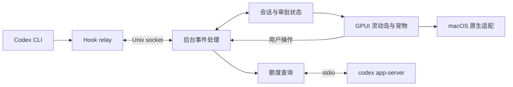

# codex-notch

[toc]

用 Rust 和 GPUI 构建的 macOS 刘海桌面伴侣，复刻 [Coucou](https://github.com/Louis-CFM/coucou) 的视觉与交互，专注于 Codex CLI。

目标是在屏幕顶部查看 Codex 的工作状态、切换会话、处理审批，并让宠物随着任务进度做出反应。继续使用现有 Codex CLI 和官方登录流程。

> 当前已实现 GPUI 顶部透明窗口、宠物绘制与眼神跟随、展开/收起交互，以及通过 Unix socket 更新多会话卡片。当前使用自定义模拟协议，尚未接入真实 Codex 事件、审批或额度查询。

## 项目范围

- 仅支持 macOS，适配带刘海的 MacBook 和没有刘海的显示器。
- 仅接入 Codex CLI，支持同时观察多个会话。
- 界面、宠物外观、动画和交互以上游 Coucou 为参考。
- 个人学习与娱乐项目，当前不发布应用。

## 计划功能

| 功能 | 目标 |
| --- | --- |
| 刘海灵动岛 | 隐藏、悬停露出、点击展开；无刘海时显示顶部浮条 |
| 实时状态 | 展示思考、工具执行、等待审批、完成与错误等状态 |
| 多会话 | 查看各个 Codex 会话的活动与待处理请求 |
| 审批卡 | 一次性允许、拒绝或回到终端处理 |
| 额度展示 | 查看 Codex 用量、额度窗口和重置时间 |
| 终端跳转 | 返回会话所在终端；精确定位能力按终端适配情况提供 |
| 宠物互动 | 呼吸、眨眼、眼神跟随，以及工作、等待、完成等动画 |
| 菜单栏与设置 | 打开灵动岛、配置接入、控制展示与动画、退出应用 |

多模型聊天、第三方服务集成、iPhone 和云同步不属于首期范围。

## 技术方案

| 技术 | 职责 |
| --- | --- |
| [GPUI](https://gpui.rs/) | 界面布局、任务列表、审批卡、设置页、宠物绘制与动画 |
| Rust | 会话状态、事件处理、配置和进程管理 |
| std::os::unix::net / std::thread | Unix socket 监听与客户端消息读取 |
| async-channel | 将后台线程收到的会话更新传递给 GPUI 异步任务 |
| serde / serde_json（计划） | 事件、IPC 消息和配置的序列化 |
| objc2 / AppKit（计划） | 补充菜单栏、刘海屏幕几何和特殊窗口行为等 macOS 能力 |

当前直接依赖 GPUI 0.2.2 和 async-channel 2.5。socket 读取运行在后台线程，GPUI 异步任务通过通道接收消息并刷新视图。serde / serde_json 和 objc2 / AppKit 属于后续方案，尚未引入。

## 后续接入方案（待验证）



上图是后续接入设想。真实事件来源、Hook relay、审批回传和额度查询方式，均需结合实际 Codex CLI 版本及官方支持核实。

## 开发进度

- [x] 确定 macOS + Codex CLI 的项目范围与 GPUI 技术路线
- [x] 实现顶部透明、无边框窗口
- [x] 实现紧凑/展开布局、宠物绘制与眼神跟随
- [x] 实现多会话卡片与列表滚动
- [x] 实现 Unix socket 模拟消息接入与正常退出清理
- [x] 实现按会话编号更新项目名和状态
- [ ] 验证鼠标穿透和多屏行为
- [ ] 实现宠物动画
- [ ] 接入真实 Codex 事件
- [ ] 实现审批、额度和终端跳转
- [ ] 完成菜单栏与设置

## 运行与模拟验证

在项目根目录启动应用：

```sh
cargo run
```

另开终端连接 socket：

```sh
nc -U /tmp/codex-notch.sock
```

每行发送一条消息，格式为：

```text
会话编号|项目名|状态
```

例如：

```text
demo-1|codex-notch|working
demo-2|Rust学习|awaiting_approval
demo-1|codex-notch|finished
```

当前支持 `working`、`awaiting_approval`、`finished` 三种输入状态。编号和项目名不能为空，也不能包含分隔符 `|` 或换行。旧的两段格式 `编号|状态` 已不再支持。

合法消息入通道后回复 `ok`；非法消息回复 `error: 原因`，连接保持可用。`ok` 表示消息已进入通道，界面随后异步更新。

相同编号更新已有卡片的项目名和状态，不同编号新增卡片。点击岛展开列表，使用滚轮或触控板查看更多卡片，通过 `Collapse` 收起。

会话仅保存在内存中。客户端断开后保留卡片，应用重启后清空。

运行解析测试：

```sh
cargo test --lib socket::tests
```

正常应用退出会清理 socket 文件。使用 Ctrl+C 或强制结束后，若下次启动提示地址被占用，先确认旧应用进程已停止，再手动清理：

```sh
rm /tmp/codex-notch.sock
```

## 设计文档

- [GPUI 项目搭建与教学计划](docs/2026-10-08-gpui-learning-plan.md)
- [MVP 架构与模块接口](docs/2026-10-08-coucou-rust-macos-design.md)

该文档是早期设计草案，其中 AppKit 主界面、原创角色及 crate 拆分方案尚未按最新决定更新。当前技术路线以本 README 的 **GPUI 主界面 + 必要的 macOS 原生适配** 为准。

## 致谢

[Louis-CFM / Coucou](https://github.com/Louis-CFM/coucou) 是本项目的功能、视觉和交互参考。原项目代码及素材的许可说明见其 [LICENSE](https://github.com/Louis-CFM/coucou/blob/main/LICENSE) 和 [LICENSE-ASSETS.md](https://github.com/Louis-CFM/coucou/blob/main/LICENSE-ASSETS.md)。
